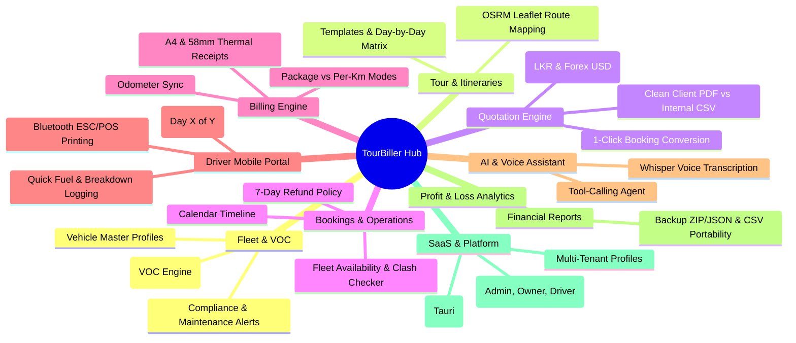
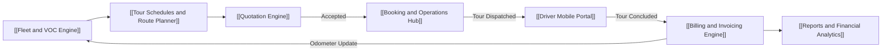

# 🏠 TourBiller / VIGIL — Second Brain (Map of Content)

> **"A single unified Second Brain for TourBiller (Smart Travel & Fleet Management Platform)."**  
> මෙතනින් ඔබට system එකේ සෑම module එකක්ම, formula එකක්ම, සහ technical specification එකක්ම bilateral links (`[[...]]`) ඔස්සේ පහසුවෙන් navigate කළ හැක. Obsidian වල **Graph View** (`Ctrl + G`) බැලූ විට මේ සියල්ල එකිනෙකට සම්බන්ධ වන අයුරු දැකගත හැක.

---

## 🗺️ Visual Ecosystem Mind Map

---

## 📂 Core Business Modules

| Module | Core Responsibility | Key Links |
| :--- | :--- | :--- |
| **01. Fleet & VOC** | වාහන විස්තර, Maintenance Alerts සහ ධාවන වියදම් (VOC Engine) | [[Fleet and VOC Engine]] |
| **02. Tour Schedules** | සංචාර සැලසුම්, Day-by-Day වියදම් සහ OSRM සිතියම් මාර්ග | [[Tour Schedules and Route Planner]] |
| **03. Quotation Engine** | Dual-audience මිල ගණන්, Live Forex, A4/CSV Exports | [[Quotation Engine]] |
| **04. Bookings & Operations** | Availability & Conflict checker, Calendar, Refund policy | [[Booking and Operations Hub]] |
| **05. Billing Engine** | Package vs Per-Km modes, Odometer audit, Thermal printing | [[Billing and Invoicing Engine]] |
| **06. Driver Portal** | Mobile PWA, Quick action logger (Fuel, Breakdown), On-road print | [[Driver Mobile Portal]] |
| **07. AI & Voice Hub** | Conversational tool-calling agent, Whisper voice input | [[AI Assistant and Speech Hub]] |
| **08. Reports & Analytics** | Revenue, VOC vs Net Profit, Full backup & restore | [[Reports and Financial Analytics]] |
| **09. SaaS & Platform** | Business profile, Roles (Admin/Owner/Driver), Tauri desktop | [[Multi-Tenant SaaS and Settings]] |

---

## 🛠️ Technical Specifications & Quick References

- 🗄️ Database Architecture: [[Database Schema and Entities]]
- 🌐 Local vs Foreign Travelers: [[Dual Audience and Currency Engine]]
- 💰 Math & Business Rules: [[Calculation Formulas and Algorithms]]

---

## 🔄 Core Business Lifecycle Workflow

