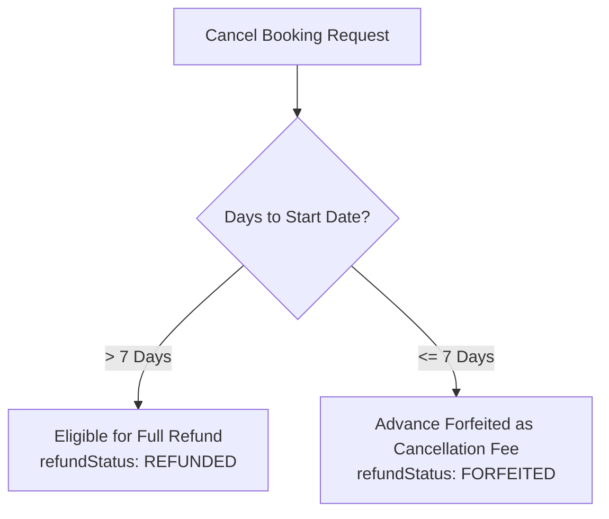

# 📅 Booking & Operations Hub

Related Hub: [[00 - TourBiller Hub (MOC)]]  
Upstream Sources: [[Quotation Engine]]  
Downstream Targets: [[Driver Mobile Portal]], [[Billing and Invoicing Engine]]  
Schema: [[Database Schema and Entities#Booking]]

---

## 📌 Overview
The **Booking & Operations Hub** is the nerve center for confirmed vehicle and tour reservations. It assigns drivers, tracks advance payments, enforces strict cancellation/refund rules, and guarantees that vehicles and drivers are never double-booked.

---

## 🔑 Key Features & Components

### 1. Reservation Management
- **Customer Linking**: Associated with customer record (`Customer` model).
- **Date Range**: `startDate` to `endDate` defining tour window.
- **Assigned Assets**: Specific `vehicleNo` and assigned designated driver (`driverId`).
- **Advance Deposit**: Tracks `advanceAmount` collected up-front to reserve dates.

### 2. Smart Availability & Conflict Checker
Prevents double-booking disasters before confirming reservations:
- Queries database across `bills`, `bookings`, and active `quotations`.
- Checks for overlapping calendar dates for:
  1. The selected **Vehicle**.
  2. The assigned **Driver**.
- Highlights conflicts in real time with an amber warning banner.

### 3. Interactive Fleet Calendar
- Visual timeline displaying fleet utilization across days and weeks.
- Color-coded status badges:
  - 🟢 **CONFIRMED**: Ready for dispatch / upcoming.
  - 🔵 **IN PROGRESS / ON TOUR**: Active on the road.
  - ⚪ **COMPLETED**: Tour concluded, ready for billing.
  - 🔴 **CANCELLED**: Booking cancelled.

### 4. 7-Day Cancellation & Refund Rules
Implements automated business rules for advance deposit disposition:

---

## 📂 Source Code References
- Creation UI: `src/components/BookingCreator.tsx`
- Cancel Action: `src/components/CancelBookingButton.tsx`
- Server Actions: `src/lib/booking-actions.ts`
- Routes: `src/app/bookings/page.tsx`, `src/app/calendar/page.tsx`
