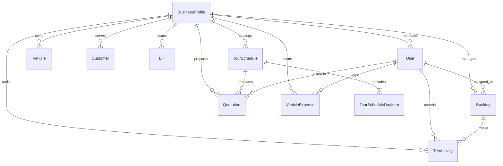

# 🗄️ Database Schema & Entities

Related Hub: [[00 - TourBiller Hub (MOC)]]  
Prisma File: `prisma/schema.prisma`

---

## 📌 Entity Relationship Diagram

---

## 📋 Core Models Breakdown

### 1. `BusinessProfile`
- Master organization entity (Multi-tenant partition key).
- Stores company name, contact, logo, bank credentials, default currency, and current USD conversion benchmark.

### 2. `Vehicle`
- Assets belonging to the fleet.
- Carries specifications, rental pricing models, preventative maintenance mileage thresholds, and VOC tracking parameters.

### 3. `Customer`
- CRM record storing client name, email, phone, and physical address.

### 4. `TourSchedule` & `TourScheduleDayItem`
- Multi-day catalog templates.
- Day items break down transit distances and daily expense allowances (hotel, food, activities).

### 5. `Quotation`
- Proposal records linking customer, tour schedule, vehicle, and pricing calculations.
- Contains status workflow (`DRAFT`, `SENT`, `ACCEPTED`, `EXPIRED`).

### 6. `Booking`
- Confirmed tour reservations.
- Tracks assigned driver, vehicle, start/end dates, advance deposits, and cancellation refund status.

### 7. `Bill`
- Finalized billing invoices.
- Records odometer readings, rate modes, waiting hours, road toll passes, and final balances.

### 8. `VehicleExpense` & `TripActivity`
- Real-time event and expenditure ledgers recorded by drivers in the field.
- Tracks fuel stops, repairs, breakdowns, hotel check-ins, and mileage progress.
